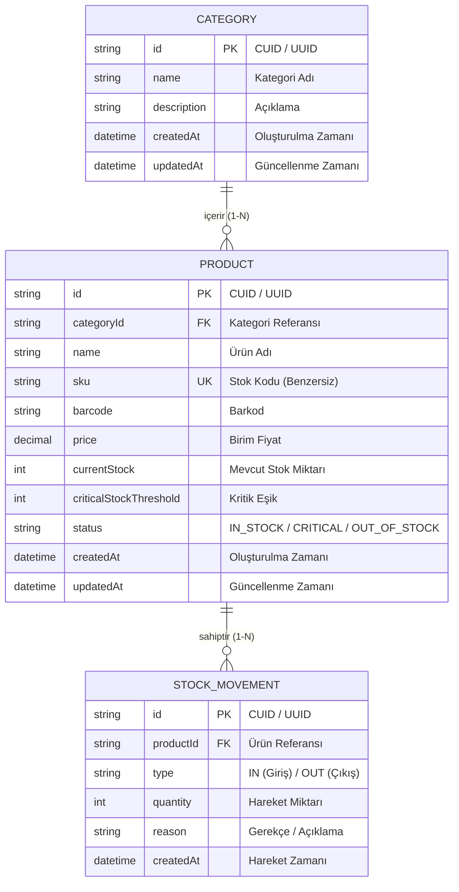

Canlı adres: [Henüz yayınlanmadı]

# Mini Katalog ve Stok Takibi Sistemi (BTÖ-303 Ara Uygulaması 2)

**Öğrenci No:** 24053035006  
**Teknoloji Yığını:** Next.js (App Router), TypeScript, Prisma ORM, Neon PostgreSQL, Tailwind CSS, Zod, Vitest

---

## 1. Konsept ve Problem Tanımı
Bu sistem, küçük ve orta ölçekli perakende işletmelerinin, butiklerin ve e-ticaret satıcılarının envanterlerini hatasız yönetebilmeleri amacıyla geliştirilmiş bir dijital katalog ve stok takip platformudur. İşletme sahipleri ve depo sorumluları, geleneksel defter veya karmaşık Excel tabloları yerine ürünlerini kategorilerine göre organize edebilir ve anlık stok durumlarını tek bir merkezden görüntüleyebilir. Sistemin çözdüğü temel problem; yetersiz veya kontrolsüz stok çıkışları sebebiyle yaşanan sipariş iptalleri, mükerrer sayımlar ve envanter tutarsızlıklarıdır. Sistem, her ürün için kritik stok eşiklerini otomatik kontrol ederek işletmeyi uyarır ve mal kabulü veya satış kaynaklı stok değişimlerini ayrıntılı hareket geçmişiyle kayıt altına alır. Böylece işletmeler ürün tedarik döngülerini zamanında planlar, stok kaybını en aza indirir ve operasyonel verimliliklerini artırır.

---

## 2. Varlıklar (Entities)
Sistem konsepte özgü üç temel varlık ve ilişkileri üzerinden modellenmiştir:

1. **Kategori (`Category`)**: Ürünlerin mantıksal gruplandırılmasını sağlar (Örn: "Elektronik", "Giyim", "Kırtasiye"). Bir kategori birden fazla ürüne sahip olabilir.
2. **Ürün (`Product`)**: Katalogda yer alan ticari ürünü temsil eder. Ad, SKU (stok kodu), barkod, birim fiyat, mevcut stok miktarı ve kritik stok seviyesi gibi özellikleri barındırır.
3. **Stok Hareketi (`StockMovement`)**: Bir ürüne ait tüm fiziksel stok giriş ve çıkışlarını temsil eder. Hareket türü (Giriş/IN, Çıkış/OUT), miktar, işlem açıklaması/nedeni ve işlem tarihi bilgilerini saklar.

---

## 3. Konsepte Özgü İş Kuralları (Business Rules)
Sistemin güvenilirliğini sağlamak adına iş kuralları `lib/rules/` altında framework bağımsız **saf fonksiyonlar (pure functions)** olarak kurgulanmış ve birim testlerle güvenceye alınmıştır:

1. **Yetersiz Stokta Çıkış Engelleme Kuralı (`validateStockDeduction`)**:
   - Bir ürün için stok çıkışı (satış, zayiat vb.) yapılmak istendiğinde, talep edilen miktar mevcut ürün stok miktarından fazla olamaz.
   - Fonksiyon mevcut stoktan fazlasını düşürmeye izin vermez; aksi halde işlemi reddederek hata fırlatır ve stok miktarının negatif değerlere düşmesini engeller.
2. **Kritik Stok Uyarısı ve Otomatik Durum Belirleme Kuralı (`calculateStockStatus`)**:
   - Bir ürünün stok seviyesi güncellendiğinde, güncel miktar ürünün tanımlı `criticalStockThreshold` (kritik stok eşiği) değerinin altına düşerse ürün durumu otomatik olarak `CRITICAL` (Kritik Stok) olarak işaretlenir.
   - Stok 0 olduğunda `OUT_OF_STOCK` (Tükendi), eşiğin üstünde olduğunda ise `IN_STOCK` (Normal) durumuna geçer.
3. **İlişkili Ürünleri Bulunan Kategorinin Silinme Kuralı**:
   - Bünyesinde aktif ürün barındıran bir kategori doğrudan silinemez (Restrict politikası); öncelikle ürünlerin başka bir kategoriye taşınması veya silinmesi zorunlu tutulur.

---

## 4. Varlık İlişki Diyagramı (Mermaid ER Diagram)



---

## 5. Kurulum ve Çalıştırma

```bash
# Bağımlılıkları yükleyin
npm install

# Prisma şemasını oluşturun ve veritabanına uygulayın
npx prisma generate
npx prisma db push # veya npx prisma migrate dev

# Tohum verileri yükleyin
npm run db:seed

# Geliştirme sunucusunu başlatın
npm run dev

# Testleri çalıştırın
npm run test
```
